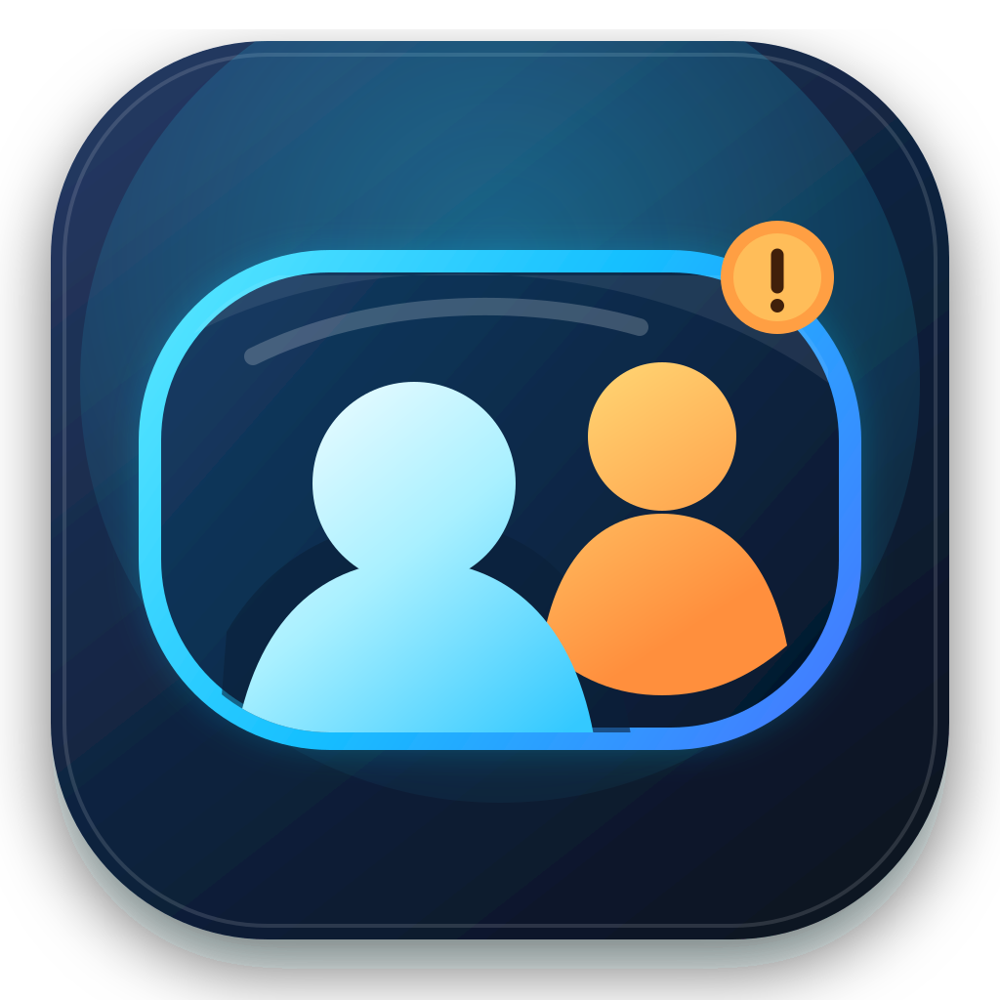

# BehindMe

一个原生、轻量、注重隐私的 macOS 菜单栏“后视镜”应用。



## 当前功能

- 菜单栏常驻
- 可调整大小的镜像摄像头窗口
- 窗口始终置顶，并可跨桌面与全屏空间显示
- 使用 Apple Vision 在本机检测人脸数量
- 可设置在检测到 1、2、3 或 4 张脸时提醒（1 张脸适合测试）
- 菜单栏表情提醒，可从 7 种系统提示音中选择并即时试听
- “仅耳机播放”默认开启，可由用户关闭；关闭后提示音会跟随 macOS 当前输出设备，包括扬声器
- 不录像、不保存画面、不发送网络请求

## 构建

需要 macOS 13 或更高版本，以及 Apple Command Line Tools：

```bash
git clone https://github.com/ashhhi/BehindMe.git
cd BehindMe
chmod +x build.sh
./build.sh
```

生成的应用位于：

```text
build/BehindMe.app
```

第一次打开后，点击菜单栏中的 `◉`，选择“显示摄像头”或“开启人脸提醒”，然后按系统提示授予摄像头权限。

## 隐私设计

摄像头帧只会在内存中用于实时预览和 Vision 人脸数量检测。项目没有录像、文件保存、遥测或网络代码。

## 后续可加入

- 摄像头设备选择
- 开机自动启动
- 自定义窗口尺寸与透明度
- 无障碍视觉提示
- 正式应用图标、Developer ID 签名和公证
